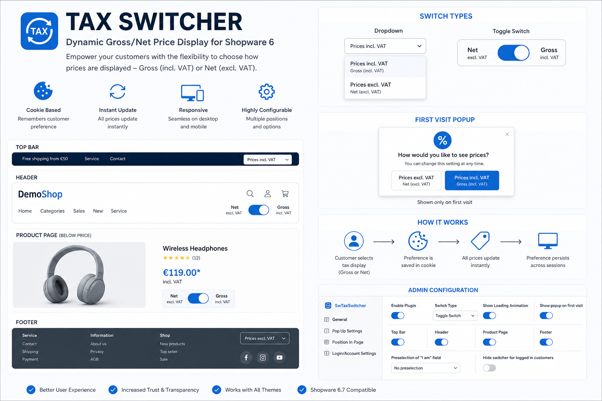

# Tax Switcher for Shopware 6

<p align="left">
  
  
  
  
  
</p>

A professional Shopware 6 plugin that enables dynamic gross/net price display switching for your storefront, providing customers with flexible tax display options.

## Features



### Core Functionality
- **Dynamic Tax Display Switching**: Allow customers to toggle between gross (incl. VAT) and net (excl. VAT) price displays
- **Multiple Switch Types**: Choose between dropdown or toggle switch UI components
- **Persistent User Preference**: Customer choice is saved via cookies for consistent experience across sessions
- **First Visit Modal**: Optional popup to prompt customers for their preferred tax display on first visit

### Flexible Positioning
Display the tax switcher in multiple strategic locations:
- Top bar navigation
- Main header
- Product detail pages (below price)
- Footer
- Mobile off-canvas menu (commented out, ready to enable)

### Configuration Options
- Enable/disable the plugin per sales channel
- Choose between dropdown or toggle switch display
- Show/hide loading animation during tax mode changes
- Control first visit popup behavior
- Configure visibility in different page sections
- Pre-select "I am" field during registration/checkout
- Hide switcher for logged-in customers (optional)

### Technical Features
- **PSR-4 Compliant**: Clean namespace structure following PHP standards
- **Decorator Pattern**: Extends SalesChannelContextFactory without breaking core functionality
- **Shopware 6.7 Compatible**: Built and tested for Shopware 6.7.x
- **Responsive Design**: Works seamlessly on desktop and mobile devices
- **Performance Optimized**: Minimal overhead with efficient cookie-based state management
- **Clean Code**: Production-ready with no debug code or placeholders

## Requirements

- Shopware 6.7.0 or higher
- PHP 8.1 or higher

## Installation

### Via Composer (Recommended)
```bash
composer require taxswitcher/sw-tax-switcher
bin/console plugin:refresh
bin/console plugin:install --activate SwTaxSwitcher
bin/console cache:clear
```

### Manual Installation
1. Download the plugin
2. Extract to `custom/plugins/SwTaxSwitcher`
3. Run the following commands:
```bash
bin/console plugin:refresh
bin/console plugin:install --activate SwTaxSwitcher
bin/console cache:clear
```

### Build Assets (if needed)
```bash
bin/build-storefront.sh
```

## Configuration

Navigate to **Settings → System → Plugins → Tax Switcher** in your Shopware administration panel.

### General Configuration
- **Enable**: Activate/deactivate the plugin
- **Switch Type**: Choose between "Dropdown" or "Toggle Switch"
- **Show Loading Animation**: Display loading overlay during tax mode changes

### Pop Up Settings
- **Show popup on first visit**: Enable first-visit modal to prompt users for preference

### Position in Page
Configure where the tax switcher appears:
- **Show in the Top Bar**: Display in top navigation bar
- **Show in the header**: Display in main header section
- **Show on the product page**: Display below product price
- **Show in the footer**: Display in footer section

### Login/Account Settings
- **Preselection of "I am" field**: Auto-select account type during registration
- **Hide gross/net Switcher for logged in customers**: Only show switcher to guest users

## Usage

Once installed and configured, the tax switcher will automatically appear in the configured locations. Customers can:

1. Click the toggle/dropdown to switch between gross and net prices
2. Their preference is saved automatically via cookies
3. All prices throughout the shop update instantly to reflect their choice
4. The preference persists across browsing sessions

## Technical Architecture

### Namespace Structure
```
TaxSwitcher\
├── Core\
│   └── Context\
│       └── SalesChannelContextFactory.php
├── Storefront\
│   └── Controller\
│       └── TaxSwitcherController.php
└── SwTaxSwitcher.php (Main Plugin Class)
```

### Key Components

**SalesChannelContextFactory (Decorator)**
- Decorates Shopware's core SalesChannelContextFactory
- Reads tax mode from cookie
- Adjusts customer group display settings accordingly
- Recalculates tax state based on customer preference

**TaxSwitcherController**
- Handles tax mode switching requests
- Manages cookie creation and updates
- Serves first-visit modal content
- Provides AJAX endpoints for seamless switching

**Frontend Plugin (JavaScript)**
- Manages UI interactions
- Handles form submissions via AJAX
- Controls loading animations
- Manages first-visit modal display logic

### Routes
- `taxswitcher.tax.switch` - POST/GET endpoint for switching tax mode
- `taxswitcher.tax.switch.modal` - GET endpoint for first-visit modal

### Configuration Keys
All configuration is namespaced under `SwTaxSwitcher.config.*`:
- `taxSwitcherEnable`
- `taxSwitchType`
- `taxSwitcherLoadingAnimation`
- `showFirstVisitPopUp`
- `taxSwitcherTopBar`
- `taxSwitcherHeader`
- `taxSwitcherProductDetail`
- `taxSwitcherFooter`
- `preselectionIamField`
- `taxSwitcherLoggedCustomers`

## Customization

### Styling
Override the default styles by targeting these CSS classes:
- `.tax-switch` - Main container
- `.tax-switch-form` - Form wrapper
- `.navigation-tax-switcher` - Navigation wrapper

### Templates
All Twig templates can be extended using Shopware's template inheritance:
```twig

```

### JavaScript
Extend the TaxSwitcherPlugin class to add custom behavior:
```javascript
import TaxSwitcherPlugin from './tax-switcher/tax-switcher';

export default class CustomTaxSwitcherPlugin extends TaxSwitcherPlugin {
    // Your custom logic
}
```

## Troubleshooting

### Prices not updating after switch
- Clear Shopware cache: `bin/console cache:clear`
- Check browser cookies are enabled
- Verify plugin is activated in admin panel

### Switcher not appearing
- Check configuration settings in admin panel
- Ensure correct position is enabled
- Clear theme cache and rebuild storefront
- Check browser console for JavaScript errors

### First visit modal not showing
- Verify "Show popup on first visit" is enabled
- Clear browser cookies to test
- Check that `taxPromptShown` cookie is not already set

## Development

### Running Tests
```bash
vendor/bin/phpunit
```

### Code Quality
The plugin follows:
- PSR-4 autoloading standard
- Shopware 6 coding guidelines
- Clean code principles
- SOLID design patterns

## Support

For issues, feature requests, or contributions, please contact the plugin maintainer.

## License

MIT License - See LICENSE file for details

## Changelog

### Version 1.0.0
- Initial release
- Complete namespace refactoring from legacy codebase
- Production-ready implementation
- Full Shopware 6.7 compatibility
- Comprehensive configuration options
- Multi-position display support
- Responsive design
- Cookie-based preference persistence

## Credits

Developed for professional Shopware 6 e-commerce implementations.

---

**Plugin Name**: SwTaxSwitcher  
**Technical Name**: SwTaxSwitcher  
**Namespace**: TaxSwitcher  
**Composer Package**: taxswitcher/sw-tax-switcher  
**Shopware Version**: 6.7.x  
**PHP Version**: 8.1+
